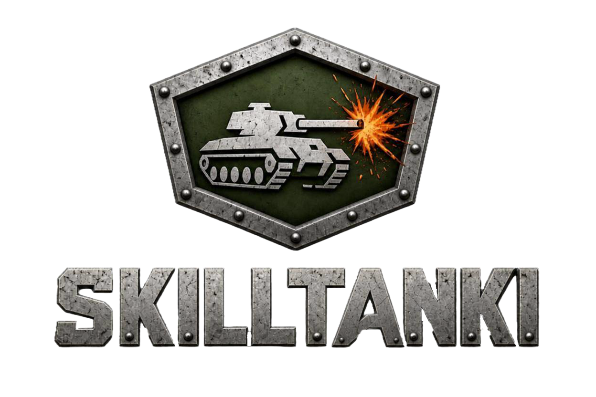
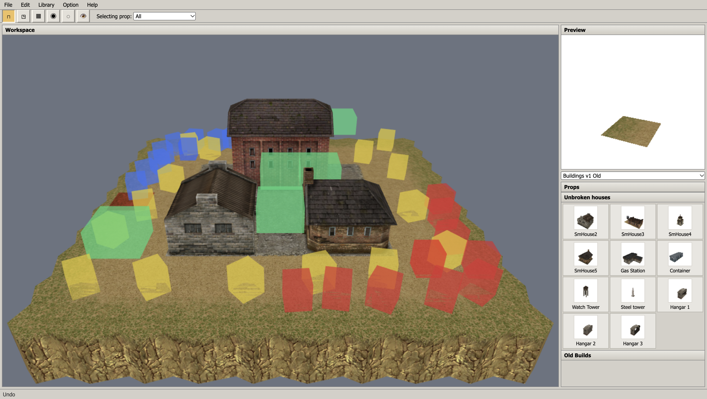

A browser map editor for the SkillTanki game: a port of the original 2010 tank game's AIR level editor to TypeScript and PlayCanvas. Open the page, and the default map is loaded a few seconds later with every prop library in the palette: boxy hangars, houses, containers, grass, dirt and concrete tiles, cliffs, bridges and slopes. Place props on the lattice, rotate them, swap textures, drop spawn points, bonus regions and flags, then export a map XML the game loads as is.

**No install, no account.** The editor runs in a desktop browser from a static build; the map data (prop libraries and the shipped maps) is served from the same store the game reads.

## Screenshot



Menu bar and toolbar on top, the **Workspace** viewport in the middle, the **Preview** pane with the spinning selected prop and the **Props** accordion on the right, the status line at the bottom. The coloured boxes are the collision view of the tiles.

## What is in the editor

- **Every prop library the game ships**, loaded up front for the palette: 11 libraries (Buildings, Builds, Castle, Complex Build, Elements, Land, Landscape, kahgel, kariz, yonje, zamin), each a set of `.3ds` meshes with named diffuse texture variants, plus billboard sprites such as trees.
- **53 classic maps**, the game's bundled summer set, every one openable from the registry with `?map=<id>` in the URL. Each map's own light XML is downloaded first, so the loading bar counts real files instead of guessing.
- **Functional props as first-class citizens:** spawn points, bonus regions and CTF flags are procedural gizmos with no mesh. The original dropped them on load because they needed a prop library that never existed; here they survive import, save and export.
- **Occupancy grid and snap:** the placement lattice is 5 m on X/Y and 3 m vertically. Snap mode seats every prop in a sparse occupancy map so a conflict is detected on the spot, and Q selects the conflicting props.
- **Undo and redo** through an event journal: add, delete, copy, move, rotate and texture change, all of them on the whole selection. Texture changes were not undoable in the original.
- **Collision view:** Option -> Collision boxes draws the collision primitives of every tile, the same boxes, planes and triangles that go into the exported XML.
- **Multiple-prop modes:** Unlock, Lock group and Lock decide how a selection behaves against the occupancy grid when it is moved as one.

## File formats

- **Tanks XML** (File -> Export to Tanks / Import from Tanks) is the map format the game reads. Element order, attribute names and number formatting match the shipped maps byte for byte: positions with 3 decimals, rotations with 6. Collision primitives are derived from the `box*`, `plane*` and `tri*` child meshes of each tile's `.3ds`. Triangles are new: the original exporter silently dropped them, and every shipped map depends on them for ramps and bridges.
- **`.lvl`** (File -> Open / Save / Save as) is the editor's own binary format, a big-endian stream of records with library, group, name, position, rotation, the free flag and the texture name. Existing `.lvl` files from the AIR editor load unchanged, and a record naming a prop no library provides is skipped and counted rather than aborting the parse.

Files are read through a browser file picker and written through a download, because a browser tab has no AIR file dialog.

## Controls

The shortcut list is the original editor's, and Help -> Help shows it in the app:

- **Props** — click a cell in the Props accordion to stick a prop to the cursor, Space to paste it. Esc deselects or drops the stuck prop, Delete or C deletes, X and Z rotate, arrows or drag move, Shift + drag copies, V + drag or W and S move vertically, F mirrors the texture, Q selects conflicting props.
- **Camera** — middle mouse pans, Alt + middle rotates, N and M yaw, Numpad 8/2/4/6 move, Numpad 9/3 tilt, Numpad +/- zoom.
- **Menus** — Ctrl+N new, Ctrl+O open, Ctrl+S save, Ctrl+Alt+S save as, Ctrl+T export to Tanks, Ctrl+I import from Tanks, Ctrl+Z undo, Ctrl+Y redo, Ctrl+Alt+C clear. The Library menu (Load, Clear and load) is kept for parity with the original but has no action yet: every library is already loaded at start. On macOS Cmd stands in for Ctrl. Bindings compare key codes, so they survive a non-Latin keyboard layout.
- **Toolbar** — snap mode, collision view, grid, the property panel (textures for tiles, bonus types for bonus regions), hide selected props, show all. The "Selecting prop" combo filters picking to All, Tile, Sprite or Bonus + Spawn.

## Running

```sh
npm install
npx vite          # dev server on http://localhost:5173
```

`public/` is committed (binaries through git LFS) and already holds every prop library, the maps and the two registries, so the editor works without any sync step.

**Do not run `npm run dev`, `npm run build` or `npm run preview` in this standalone checkout.** Their `pre*` hooks call `scripts/sync-assets.mjs`, which wipes `public/` and then rebuilds it from the monorepo layout two directories up (`../../assets` and `../../maps.json`). Without that layout the script deletes the committed data and fails. Build with the commands directly:

```sh
npx tsc --noEmit && npx vite build                          # local build, data at /
npx tsc --noEmit && VITE_ASSET_BASE=/assets/ npx vite build  # deploy build, data from R2 at /assets/
```

The production bundle is minified with terser and then obfuscated, with hash-only chunk names so the module map does not leak through URLs. `copyPublicDir` is off: in production the same map and prop tree is streamed from the shared R2 bucket, uploaded once with `scripts/upload-assets.mjs` (needs `R2_ACCOUNT_ID`, `R2_ACCESS_KEY_ID`, `R2_SECRET_ACCESS_KEY`; `--local` targets a local workerd through wrangler). The upload is idempotent: objects whose size and md5 already match are skipped.
